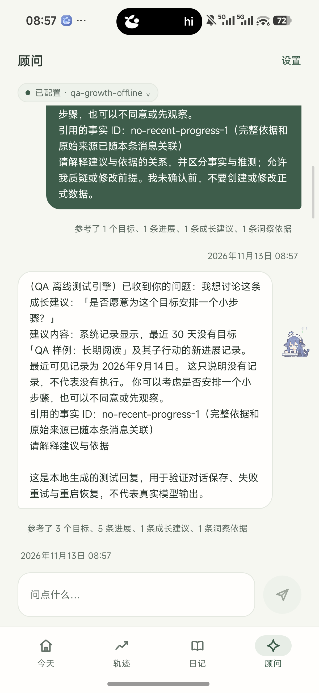
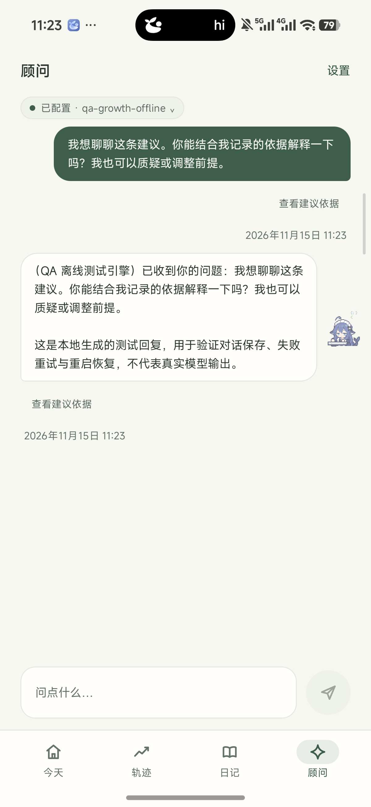

# MengYa Life 0.25.2.1 — 验收记录

基线：`1f8908105874c187a535b95da5ebbd32b8ec5e5c`；versionName 0.25.2.1 / versionCode 38。实现提交：`954fcde716dabe35c9fce97bda953c1fc0191d59`；QA/Care fence 补充提交：`75bec28600a361b4c7f432d7781b740469f3d9cb`。

## 本地验证

| 项目 | 结果 | 说明 |
|---|---|---|
| `:app:testDebugUnitTest` | **PASS** | 430 tests，0 failures / 0 errors / 0 ignored。 |
| `:app:assembleDebug` | **PASS** | Debug APK 构建成功。 |
| `:app:assembleQa` | **PASS** | QA APK 构建成功。 |
| `:app:assembleQaAndroidTest` | **PASS** | Instrumented 测试 APK 编译/打包成功。 |
| AndroidJUnitRunner（ADB 直接执行） | **PASS** | `OK (24 tests)`；24/24 Instrumented 用例通过。 |
| `:app:connectedQaAndroidTest` Gradle 任务 | **PARTIAL** | 首次运行发现 CareRunner BUSY 偏好测试缺少安全延期决策，修复后 24/24 tests 执行且 XML failures=0；UTP `onAfterAll` 无法执行 `/opt/android-sdk/build-tools/35.0.1/aapt`，Gradle 命令因此 exit 1。绕过清理钩子后 ADB AndroidJUnitRunner 直接执行，exit 0 / `OK (24 tests)`。 |
| `:app:lintDebug` | **PASS** | 0 errors / 40 warnings（已有 API/依赖/资源告警）。 |

## AdvisorEngine.chat 调用计数

以下是 JVM 测试中 `ScriptedAdvisorEngine.calls` 对实际代码 `AdvisorEngine.chat()` 接口的计数，不是外部供应商调用量：

| 场景 | Advisor chat 次数 | 断言结果 |
|---|---:|---|
| 主回复后撤权、附加提取前 | 1 | 无附加调用/草案 |
| 附加计划提取期间撤权 | 2 | 第二次结果丢弃，无候选/自动应用 |
| 主回复后切 endpoint 或 model | 1 | 不向旧配置发起附加请求 |
| Restore 排队进入附加提取 | 2 | generation 变化后不落候选 |
| 取消计划/进展附加提取 | 每例 2 | 不落候选、不调用记录 apply |
| 附加计划提取超时 | 2 | 不回退创建草案 |
| JOURNAL/PROGRESS/GOALS 分别未授权 | 每例 1 | 仅主请求；被禁止类别数据不进入请求 |
| 跨 6 轮/15 分钟的同一 Insight 对话 | 10 | 稳定来源仍进入草案 |
| Insight 依据超过上下文预算 | 0 | handoff 的 Advisor 请求在发出用户消息前拒绝；准备测试建议的独立 InsightService Scripted 调用 1 次 |

`NetworkAdvisorEngineTest` 使用 `FakeTransport.calls` 断言单个 engine chat 对应一个模拟 POST。**真实外部模型调用数为 0**；未使用 QA FakeEngine 结果宣称真实模型通过，也未验证线上模型质量、真实 HTTP 延迟或服务端取消语义。

## QA 真机 UI 路径（离线合成夹具）

| Before · 0.25.2 | After · 0.25.2.1 QA Offline |
|---|---|
|  |  |

- 通过 QA-only `qa_growth_fake_engine` 与 `qa_seed_growth_loop_fixture` 初始化独立 `.qa` 包；日志确认“offline advisor configured; no network call”。所有截图中的 `QA 样例` 数据均为合成夹具，离线 FakeEngine 不代表真实模型能力。
- 完成建议生成→依据详情→自然语言 handoff→“这周读三次书”→计划草案→修改为 `QA-edited-reading-plan`→用户确认→Today/Trajectory 检视→强制停止并重启 QA 包。重启后该计划仍显示为“进行中”，执行记录仍为空。
- 旧版对照：[0.25.2 旧版顾问对话](../mengya-0.25.2/screenshots/03-advisor-discussion-qa.png)，可见旧消息中的 fact IDs/内部指令、来源统计和逐条时间标签。
- 新版截图：[QA 初始态](screenshots/00-qa-home.png)、[QA fixture Today](screenshots/01-qa-home-seeded.png)、[Insight 建议](screenshots/03-insight-qa.png)、[依据详情](screenshots/04-insight-details-qa.png)、[自然语言 handoff](screenshots/05-advisor-handoff-qa.png)、[草案待确认](screenshots/06-plan-draft-qa.png)、[草案编辑弹窗](screenshots/07-plan-edit-qa.png)、[修改后的草案](screenshots/08-plan-edited-qa.png)、[确认结果](screenshots/09-plan-confirmed-qa.png)、[Today 更新](screenshots/10-today-after-confirm-qa.png)、[Trajectory 更新](screenshots/12-trajectory-plan-qa.png)、[重启后 Today](screenshots/13-after-restart-qa.png)、[重启后 Trajectory](screenshots/14-trajectory-after-restart-qa.png)。
- 设备路径使用 QA 离线引擎；它只验证 UI/数据库数据流，不是外部模型体验证据。
